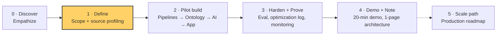

# 🧭 COMPASS — Where we are, where we're going

_Last updated: 2026-10-19_

## North Star
_Purpose (boss, 2026-10-13): an exploratory showcase of design thinking, system design and usefulness. The reasoning trail is half the deliverable._

A hospital pharmacy safety officer opens one screen each morning and, in under 2 minutes, knows:
**(1) which drugs show unlabeled adverse events, (2) which have active recalls, (3) what changed since yesterday,**
and can click any flag to see the exact source behind it.

## Right now
| | |
|---|---|
| 📍 **Phase** | 1 — Define (Design thinking: *Define*) |
| 🔨 **Step** | Sources: access guide ✅ · hand profiling ⚪ (FAERS first) · Research R1–R3 ✅ · Class decision (A003) pending your yes |
| 🎯 **Next milestone** | All 5 sources profiled → A002 findings → lock opioid list + pipeline design |
| ⛔ **Blockers** | Class choice (A003 hybrid vs opioids-only) · AEMS replaced FAERS: check public data access · Drift reading to confirm · Demo date unknown |
| ⚠️ **Top risk** | FAERS → AEMS switch may change ingestion. Showing 3–4 week drift in ~3 weeks (plan: label churn + replay history) |

## Phase map

| Phase | Done when | Status |
|---|---|---|
| 0 · Discover | Brief understood, questions asked, users understood | ✅ Done (2026-10-13) |
| 1 · Define | Scope, formulary, signal rule, "label mentions" definition decided; sources profiled | 🟡 In progress |
| 2 · Pilot build | 4+ sources raw→clean→ontology, 1 incremental pipeline, AI extraction, Workshop app with write-back | ⚪ |
| 3 · Harden + Monitor | Gold set labeled, hallucination rate measured, 1 pipeline optimized; **full monitoring live (pipeline + AI + 3–4 wk drift)** | ⚪ |
| 4 · Demo + Note | Demo rehearsed, architecture note done | ⚪ |
| 5 · Scale | Production roadmap written (not built) | ⚪ |

## Proposed 3-week plan (draft — confirm dates with boss)
| Week | Focus | Exit check |
|---|---|---|
| Wk 0 (now) | Define: profile 5 sources by hand; get Developer Tier access | Scope + data understood |
| Wk 1 | Ingest FAERS, labels, recalls, RxNorm → clean → ontology. Drug identity resolved. | Ontology browsable |
| Wk 2 | LLM label extraction + signal logic + Workshop app + triage write-back | Safety officer flow works end-to-end |
| Wk 3 | Gold set + hallucination check, optimization log, **monitoring (must)**, note, demo rehearsal | Demo-ready |

## Key decisions so far
See [docs/06-decisions/DECISIONS.md](docs/06-decisions/DECISIONS.md). Count: 15. Latest: D014 hybrid class (proposed) · D015 AI F1 ≥ 0.85 target (proposed) · D007 opioids · D008 monitoring must · D009 3–4 wk drift · D010 Developer Tier · D011 showcase purpose · D012 profile sources first.

## Active approach
[A002 — Source profiling](docs/05-approaches/A002-source-profiling.md) (in progress) · [A003 — Class: opioid-led hybrid](docs/05-approaches/A003-class-choice-hybrid.md) (proposed) · Research: [synthesis](docs/01-discovery/research/README.md)

## Change log of the compass
| Date | What moved |
|---|---|
| 2026-10-13 | Project created. Phase 0 started. Boss meeting prep ready. |
| 2026-10-13 | Added class-vs-impact options + "own Developer Tier?" question (M3a). Unblock path: free Foundry Developer Tier for prototyping. |
| 2026-10-13 | Boss meeting done → Phase 1. Class = opioids. Monitoring = must. Developer Tier. Next: source profiling. |
| 2026-10-19 | Source access guide + sampler done. Research R1–R3 done → hybrid class proposed. FAERS→AEMS switch found. |
