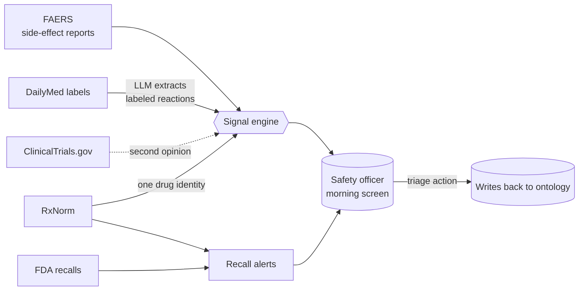

# Requirements deep-dive

_Stage: Empathize → Define · Status: Draft v0 (before boss answers)_

## 1. What exactly are we building?
A **signal monitor**, not a database. It turns four messy public feeds into a short, ranked to-do list for one person.

## 2. Requirements, made testable

| ID | Requirement (from brief) | How we'll prove it in the demo | Priority |
|---|---|---|---|
| R1 | Ingest ≥4 sources, ≥1 unstructured | Lineage graph shows FAERS, DailyMed, Enforcement, RxNorm (+CT.gov) | Must |
| R2 | raw → clean → ontology | Three clearly named layers in Foundry | Must |
| R3 | Objects: Drug, Label, Adverse Event, Recall, Signal | Ontology Manager view | Must |
| R4 | ≥1 incremental pipeline | Build history: second run processes only the new quarter or new labels | Must |
| R5 | LLM extracts labeled reactions from labels | Drill-down: passage beside extraction | Must |
| R6 | Flag frequent-but-unlabeled reactions | Ranked signal list with stats | Must |
| R7 | Ranked signal list | Workshop page 1 | Must |
| R8 | Drug drill-down, passage beside extraction | Workshop page 2 | Must |
| R9 | Recall alerts | Workshop panel | Must |
| R10 | Triage action that writes back | Click "Escalate" → Signal status changes, saved with user + note | Must |
| R11 | Every flag traces to source | Each signal links to FAERS counts, label version, passage | Must |
| R12 | "What changed since yesterday" | Change panel from daily snapshots | Must |
| R13 | Optimization log with before/after | `docs/08-optimization-log/` | Must |
| R14 | One-page architecture note | `docs/04-architecture/` | Must |
| R15 | Pipeline health monitoring | Freshness, row-count, schema, build-time/cost dashboards + alerts | **Must** (boss, 2026-10-13) |
| R16 | Hallucination check on gold set | Precision / recall table | **Must** |
| R17 | Drift across label versions / model changes | Drift over a 3–4 week rolling window; short swings ignored | **Must** (boss, 2026-10-13) |

## 3. How this adds value
| For | Value |
|---|---|
| Safety officer | Hears about problems **weeks earlier**, in **one place**, with **proof attached**. Less time hunting through FDA emails |
| Patients | Faster action on risky drugs (alerts, formulary changes, monitoring rules) |
| Hospital | Documented, auditable safety review. Supports P&T committee decisions and Joint Commission medication-management expectations |
| Soragence / us | A reusable pattern: messy public data → trusted ontology → AI with measured reliability → action. Applies far beyond pharmacy |

## 4. The hidden hard parts (where the grade really is)
1. **Drug names don't match.** FAERS has free-text drug names ("OZEMPIC 0.25MG PEN", "semaglutid"). Recalls name products and NDCs. Labels have set IDs. → One identity step on RxNorm.
2. **Reaction words don't match.** FAERS uses MedDRA terms ("Pancreatitis acute"). Labels use prose ("cases of acute pancreatitis, including fatal…"). → Matching strategy is a key decision.
3. **FAERS is not incidence.** Reports ≠ rates. Duplicates, missing data, reporting bias. → Disproportionality stats + honest wording.
4. **Different clocks.** FAERS quarterly, recalls weekly, labels daily. → Incremental design + freshness shown in the app.
5. **The LLM can invent things.** → Grounding check: every extracted reaction must appear in the passage.
6. **Labels have versions.** → Extract per version; never re-extract unchanged versions.

Details: [data-issues-register.md](../07-data-quality/data-issues-register.md)

## 5. Open definitions (need boss input → see meeting sheet)
"On the label" (M7) · "Frequent" (S6) · "Active recall" (S2) · "Since yesterday" (S3) · drug grain (S5) · triage states (S4).

## 6. Explicitly out of scope (pilot)
Patient data · prescribing advice · causality assessment · all drugs on the market · real-time alerting by email/SMS · MedDRA hierarchy (unless licensed).
