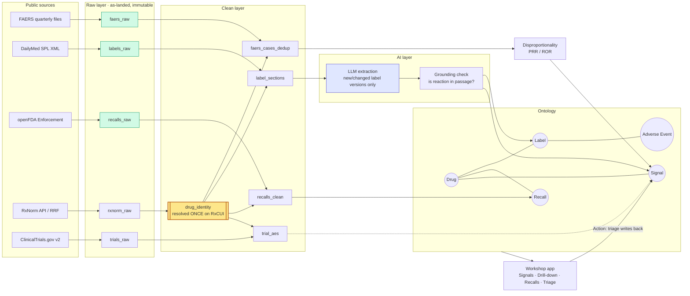
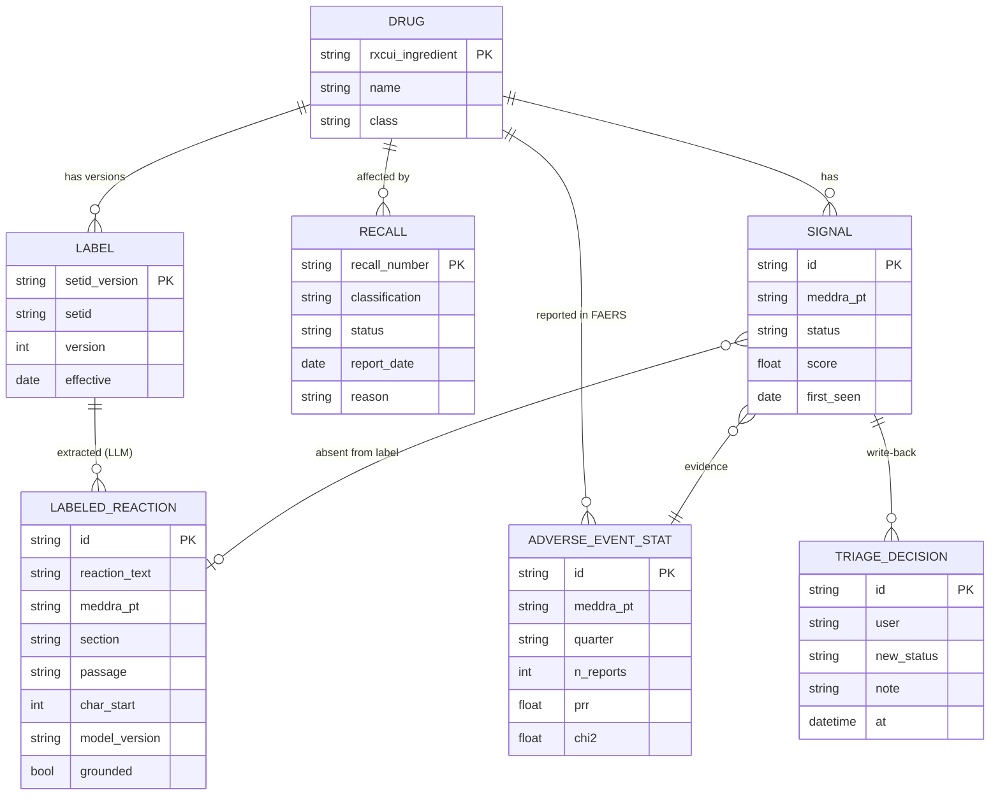

# Architecture v0 — first draft (before Foundry access)

_Status: Draft · Approach: [A000](../05-approaches/A000-project-setup.md) · Editable diagram: [diagrams/01-data-flow-v0.drawio](diagrams/01-data-flow-v0.drawio) (open in draw.io → Export as VSDX for Visio)_

## Data flow: raw → clean → ontology → app

Green = incremental. Yellow = the single drug-identity step. Blue = the expensive LLM step.

## Ontology v0

## The 4 decisions that will matter most (candidates for the 1-page note)
1. **Where drug identity is resolved:** one `drug_identity` dataset on RxNorm ingredient, used by everything.
2. **What runs incrementally:** FAERS by quarter; labels by set ID + version; recalls by report date. Signal stats are recomputed (small) on top.
3. **Where the LLM sits:** after the label clean step, only on new versions, cached by (setid, version, prompt version, model).
4. **How "unlabeled" is matched:** MedDRA PT from FAERS vs. extracted label reactions normalized to PT (LLM-assisted, then exact/synonym match).

## Chose not to do (draft)
Real-time streaming · full MedDRA hierarchy (licensing) · causality scoring · all drugs.
