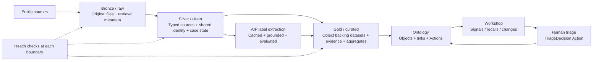
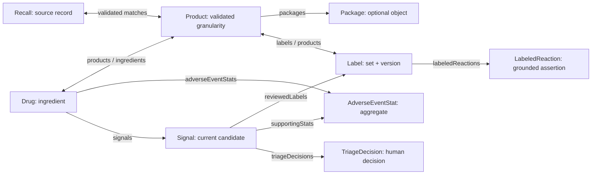

# Foundry conventions v1

**Project:** Medication Safety Signal Monitor · **Date:** 2026-10-31 · **Stage:** Define → Prototype.

Read the [build order](project-build-order-v1.md) for execution. The [research notes](tutorial-research-2026-10-31.md) distinguish tutorial lessons, verified platform behavior, and our own choices.

## 1. The rules to remember

| # | Convention for this project |
|---|---|
| 1 | Start with the safety officer's three questions and the evidence each answer needs. |
| 2 | Preserve source files in raw/bronze. Clean and resolve identifiers in silver. Publish reusable, purpose-built datasets in gold. |
| 3 | Map gold datasets into business objects. Keep technical processing tables out of the user-facing Ontology. |
| 4 | Resolve drug identity once. Keep ingredient, product, package, and label version distinct. |
| 5 | Write down each dataset's grain: what exactly one row represents. |
| 6 | Use stable keys. Never use row numbers, display names, or load timestamps as business identity. |
| 7 | Use `snake_case` for dataset columns, `PascalCase` for object API names, and `camelCase` for property API names. |
| 8 | Keep machine evidence separate from human triage decisions. |
| 9 | Record source versions, transformation rules, and AI configuration with results. |
| 10 | Prove refresh correctness and measure cost before claiming an optimization. |

These are project conventions. The detailed naming requirements for object and property API names are also supported by [Palantir's object creation documentation](https://www.palantir.com/docs/foundry/object-link-types/create-object-type).

## 2. Medallion architecture in our project

Medallion architecture means refining data through bronze, silver, and gold layers. The layers describe responsibility and readiness; a folder name alone does not establish quality.

Data Forge demonstrates raw/bronze and clean/silver in [episode 3 at 2:03](https://www.youtube.com/watch?v=LgmhVY-_rlE&t=123s). [Episode 6 at 1:28–4:27](https://www.youtube.com/watch?v=t4Db6n5hpCI&t=88s) extends this to gold outputs. The mapping below is our application of that pattern.

| Layer | Responsibility | Medication monitor examples | Must pass before moving on |
|---|---|---|---|
| **Bronze / raw** | Preserve what arrived plus retrieval metadata | FAERS (FDA adverse event report database) quarterly files; DailyMed SPL (Structured Product Labeling) XML; FDA recall responses; RxNorm identifier responses | Source URL, retrieval time, source version/period, file hash, and row/file counts captured; original content retained |
| **Silver / clean** | Parse, type, validate, and standardize; build shared identity and case state | Typed FAERS tables; latest case versions; parsed label sections; standardized recall fields; drug/product/package crosswalks | Grain declared; key and duplicate checks; unmatched joins reported; rejected records retained with reasons |
| **Gold / curated** | Produce domain facts and datasets ready to back objects | Drug records; versioned labels; aggregate reaction statistics; grounded extracted reactions; recall matches; signal candidates; change events | Unique object keys, valid links, complete evidence references, documented rule and source versions |
| **Ontology** | Represent drugs, labels, signals, recalls, relationships, and permitted Actions | `Drug`, `Label`, `AdverseEventStat`, `Recall`, `Signal`, `TriageDecision` | Keys mapped, useful titles, links navigable, Action permissions and persistence checked |
| **Workshop** | Let the officer inspect evidence and act | Ranked signals, drug drill-down, recalls, changes, triage | Three morning questions answerable; every flag opens its evidence |

**Gold is a dataset layer; the Ontology adds meaning and behavior.** Some small reference tables may feed objects with minimal further transformation. Do not add empty processing stages just to have three colors.

Palantir's broader guidance separates source cleanup from reusable cross-source transformations and Ontology hydration. Our single-project pilot uses folders for those boundaries; separate source and transform projects belong to later scaling. See [recommended project structure](https://www.palantir.com/docs/foundry/building-pipelines/recommended-project-structure).



[PNG](../../diagrams/png/18-foundry-medallion-v1.png) · [PDF](../../diagrams/pdf/18-foundry-medallion-v1.pdf) · [draw.io](../diagrams/18-foundry-medallion-v1.drawio).

## 3. Foundry folders and local repository folders

**Recommended Foundry Files layout:** create these folders inside `Medication Safety Signal Monitor`. This is a proposed platform layout, not a claim that resources already exist.

```text
Medication Safety Signal Monitor/
  Data/
    raw/                 # bronze: original public-source payloads
    clean/               # silver: validated sources + shared identity
    curated/             # gold: object backing datasets
    quarantine/          # rejected rows + reason codes
  Pipelines/             # Pipeline Builder resources and Code Repositories
  Ontology/
    Objects/
    Links/
    Actions/
  Workshop/              # the officer's app
  AIP/
    Logic/               # label extraction
    Evals/               # test cases and measured results
  Monitoring/            # health checks, run metrics, source status
  Analysis/              # investigation resources and profiling
  Documentation/         # resource descriptions and operating notes
  Scratch/               # experiments; no production dependency
```

Folders organize resources. Object types and links still need configuration in Ontology Manager; creating an `Objects` folder does not create a business model.

| Local repository location | Responsibility in Foundry |
|---|---|
| `foundry/pipelines/raw/` | Ingestion logic / configuration that populates `Data/raw` |
| `foundry/pipelines/clean/` | Source cleaning and shared identity logic for `Data/clean` |
| `foundry/pipelines/ontology/` | Curated dataset logic for `Data/curated` — our gold outputs |
| `foundry/ontology/` | Object, link, and Action definitions / notes |
| `foundry/ai-function/` | Versioned prompts, output contract, grounding checks |
| `foundry/app/` and `foundry/monitoring/` | App notes and operational checks |
| `prototypes/` | Local experiments before moving proven logic into Foundry |

Do not rename the existing repository folders merely to match tutorial vocabulary. Code resources and data outputs are different resources.

## 4. Names and descriptions

### Dataset and pipeline names — project choices

Pattern: `<layer>_<source_or_domain>_<entity>[_qualifier]`.

Use `raw`, `clean`, and `ontology` as the dataset layer prefixes. `ontology_*` means a gold dataset prepared to back an object. For shared data, use a domain such as `drug` instead of inventing a source name. Existing documented shorthand such as `drug_identity` means the shared identity dataset family; record its actual resource identifier when built.

| Resource | Example |
|---|---|
| Raw dataset | `raw_faers_demo`, `raw_dailymed_spl`, `raw_enforcement_recalls` |
| Clean source dataset | `clean_faers_cases_current`, `clean_dailymed_sections` |
| Shared identity | `clean_drug_identity`, `clean_drug_product_map` |
| Gold object dataset | `ontology_drug_drugs`, `ontology_label_labels`, `ontology_signal_signals` |
| Pipeline resource | `mssm_faers_case_state`, `mssm_label_extraction` |
| Local transform file | `faers_case_state.py` |
| Action display name / proposed ID | `Record triage decision` / `mssm-record-triage-decision` |

Avoid `final`, `final2`, `new_data`, and date suffixes on current-state datasets. Use source-period and version columns for history. A breaking schema or rule change gets an explicit version and migration note.

Every published dataset description must say: purpose, grain, key, upstream resources, owner, refresh mode, source cadence, checks, known gaps, and downstream consumers. Add the deployed resource identifier and link after creation.

### Ontology names — different names serve different purposes

| Field | Convention | Example |
|---|---|---|
| Object display name | Singular business noun | `Drug`, `Adverse event statistic` |
| Plural display name | Readable plural | `Drugs`, `Adverse event statistics` |
| Object API name | PascalCase; stable once consumers depend on it | `Drug`, `AdverseEventStat` |
| Object type ID | Lowercase with dashes; project prefix if needed | `mssm-drug`, `mssm-adverse-event-stat` |
| Property display name | Plain language | `Source as of`, `Report count` |
| Property API name | camelCase | `sourceAsOfDate`, `reportCount` |
| Backing column | snake_case; map explicitly | `source_as_of_date` → `sourceAsOfDate` |
| Primary key property | Stable identifier | `drugId` |
| Title property | Recognizable text | `ingredientName` |

These API casing rules and the distinction between title and primary key follow [Palantir's creation guide](https://www.palantir.com/docs/foundry/object-link-types/create-object-type). Check name availability before publishing. In a shared Ontology, use a consistent `Mssm` API prefix if collisions require it; do not rename unrelated objects.

Use concrete relationship names from each end, such as `drug` / `signals`. Avoid `relatedItems`. Qualify vague properties: `reportCount`, `labelMatchStatus`, and `sourceAsOfDate`. Describe meaning, allowed values, units, and null behavior. These choices follow [Palantir's structural guidance](https://www.palantir.com/docs/foundry/ontology/ontology-structural-guidance).

### Types, dates, and missing values — project choices

| Data | Convention |
|---|---|
| RxCUI (RxNorm concept identifier), application number, NDC (National Drug Code) | Strings; preserve leading zeros and source formatting; store normalized forms separately |
| Count | Integer/long; never use a floating-point count |
| Ratio / score | Double with a description of formula, population, and rule version |
| Calendar date | Dataset `_date`; Ontology `Date`, such as `sourceAsOfDate` |
| Exact time | Dataset `_at`; UTC timestamp, such as `retrieved_at` → `retrievedAt` |
| Missing evidence | Null plus a reason/status; never silently convert to zero or `false` |
| Label comparison | `mentioned`, `not_found_in_reviewed_sections`, `uncertain`, `not_evaluated` |
| Recall applicability | Preserve source recall status separately from our applicability assessment; missing lot/expiry means uncertainty |

## 5. Ontology contract: grain and keys before objects

The following is a **target contract to validate**, extending the existing [A005 merge design](../../05-approaches/A005-source-selection-and-merge.md). D020–D029 remain proposed. This guide does not approve them.

| Object | One object represents | Candidate stable key | Evidence / title |
|---|---|---|---|
| `Drug` | One ingredient | Ingredient RxCUI | Ingredient name; identity source version |
| `Product` | One product at an agreed formulation/route granularity | Validated product key; see gate below | Brand/generic + route + dosage form |
| `Package` (only if needed as an object) | One standardized package | Validated package NDC representation | Package description + product link |
| `Label` | One label set and version | SPL set ID + version | Label title, source URL, version date, original document |
| `LabeledReaction` | One distinct normalized reaction assertion for a label section and extraction configuration | Label key + section + normalized term + extraction config ID | Exact supporting quote and location; AI provenance |
| `AdverseEventStat` | One ingredient/reaction/population/window/rule combination | All dimensions, deterministically encoded | Report count, denominator, source period, computation version |
| `Recall` | One source recall record | Source namespace + source recall identifier | Reason, source status, dates, original product description |
| `Signal` | One current ingredient/reaction/rule candidate | Drug + normalized reaction + rule version | Label assessment status, evidence links, latest evaluation ID |
| `TriageDecision` | One human decision about a signal evaluation | Action-generated unique decision ID | Signal/evaluation ID, reviewer, time, status, rationale |
| `ChangeEvent` | One detected source/business change | Entity + source version pair + change type | Previous/current version, detected time, source effective date |

**Identity gate:** D027 sketches Product using application number. Do not assume one application uniquely identifies a route/formulation/product. Profile application + product number + route/form before choosing the key. Keep ingredient→product and product→label as explicit mappings. A combination product may have multiple ingredients. Ambiguous matches stay unresolved with reasons; they must not become confident label-absence flags.

**Key construction:** encode composite keys in a fixed field order with a documented delimiter/escaping scheme or canonical serialization plus hash. Test nulls and collisions. Retain the readable component columns. Include the source namespace for identifiers that are only unique within a source.

**Signal identity:** keep the current signal ID stable as new evidence arrives. Store the evaluated label keys, source periods, rule/configuration IDs, and evaluation ID separately. A triage decision records the evaluation the officer actually saw. If immutable signal snapshots become objects later, define them separately rather than changing current signal keys every refresh.

Public adverse-event source rows stay in the data layer for traceability. The user-facing object is an aggregate statistic; this project does not introduce a patient object.

### Relationships

| From → To | Cardinality to validate | Names from each side |
|---|---|---|
| Drug ↔ Product | Many-to-many, including combination products | `products` / `ingredients` |
| Product → Package | One-to-many if normalized package is unique | `packages` / `product` |
| Product ↔ Label | Many-to-many until label/product mappings are profiled | `labels` / `products` |
| Drug → AdverseEventStat | One-to-many | `adverseEventStats` / `drug` |
| Drug → Signal | One-to-many | `signals` / `drug` |
| Label → LabeledReaction | One-to-many | `labeledReactions` / `label` |
| Signal ↔ Label / AdverseEventStat | Evidence links for the current evaluation | `reviewedLabels`, `supportingStats` / `signals` |
| Signal → TriageDecision | One-to-many | `triageDecisions` / `signal` |
| Recall ↔ Product / Package | Potentially many-to-many | `affectedProducts`, `affectedPackages` / `recalls` |

Use a join dataset for many-to-many relationships. If an individual match needs confidence, method, or review status, retain those in a match dataset; promote the match to an association object if the workflow must inspect or edit it. Do not hide uncertain match evidence inside an unexplained link. This is our application of [Palantir's relationship design guidance](https://www.palantir.com/docs/foundry/ontology/ontology-structural-guidance).



[PNG](../../diagrams/png/19-foundry-ontology-conventions-v1.png) · [PDF](../../diagrams/pdf/19-foundry-ontology-conventions-v1.pdf) · [draw.io](../diagrams/19-foundry-ontology-conventions-v1.drawio). Cardinalities above remain validation targets.

## 6. Actions and write-back

An Action is a controlled operation that creates or changes Ontology objects. Start with **Record triage decision**. It records the signal, evaluation ID, decision, rationale, authenticated reviewer, and server-recorded time. Reviewer/time come from trusted execution context, not editable text inputs. Proposed decisions: `reviewing`, `dismissed`, `escalated`, `monitoring`.

Create a separate `TriageDecision` per decision. Keep source facts and calculated scores pipeline-owned. The app can derive the latest triage state. If a stored status summary is needed, define who owns it and how it reconciles with decision history.

Configure permitted submitters, required fields, allowed statuses, and an idempotency token so retrying the same submission cannot create duplicate decisions. Use Actions as the user entry point. Palantir supports Action submission testing before applying edits; see [getting started](https://www.palantir.com/docs/foundry/action-types/getting-started) and [Action permissions](https://www.palantir.com/docs/foundry/action-types/permissions).

**Acceptance check:** submit → reload → rebuild backing evidence → reopen signal. The decision must persist and still identify the evidence reviewed. An Action edits the Ontology; it does not rewrite the external FDA source. Consult [object editing behavior](https://www.palantir.com/docs/foundry/object-link-types/allow-editing) for the actual storage configuration in the enrollment.

## 7. Refresh and incremental processing

Incremental means processing newly arrived changes instead of rebuilding everything. It does not mean appending all business records forever.

| Data | Proposed build mode | Correctness condition |
|---|---|---|
| Raw source artifacts | Append versioned arrivals with manifest | Replaying a download does not create a second logical source version |
| Small reference/identity data | Snapshot rebuild initially | Changed mappings trigger replay/rebuild of affected historical joins |
| FAERS case state | Incremental upsert + deletes after validation; D022 proposed | Latest version wins across all history; deleted cases disappear from current counts |
| Reaction statistics / signals | Snapshot recompute over correct case state initially | Full reference population and denominator retained, even when the displayed formulary is small |
| Label extraction | Run only for missing configuration/content keys | Unchanged input/config → zero new model calls; failures remain retryable |
| Recalls | Preserve source versions; derive current view | Status changes update existing recalls; source status does not alone prove hospital applicability |
| Change events | Persist version transitions once | Rerun of unchanged source creates no new business change |

Pipeline Builder's incremental input processing requires additive transactions. Its window and aggregate transforms can operate only on the current transaction. A changed snapshot lookup does not automatically replay historical incremental joins. Therefore, validate the entire FAERS state algorithm; use Code Repositories for state management if the required behavior cannot be expressed clearly. See [batch computation modes](https://www.palantir.com/docs/foundry/pipeline-builder/datasets-computation-modes-for-batch).

Do not treat “Snapshot replace” as a latest-version algorithm: its duplicate rows within a transaction can be selected at random. Rank incoming case versions and deduplicate deterministically before the write. Deletions also require explicit handling. See [dataset output modes](https://www.palantir.com/docs/foundry/pipeline-builder/outputs-add-dataset-output).

Minimum correctness fixture: first case → higher version → older late version → deletion → replay. Compare the final state and counts against a full rebuild. Add a changed identity lookup case. Record build time, rows read/written, and failures in the [optimization log](../../08-optimization-log/optimization-log.md).

## 8. AI extraction and evidence contract

These are project requirements, not claims about an automatic Foundry feature.

| Concern | Convention |
|---|---|
| Input | Label set/version, section code/path, exact source text, source URL |
| Extraction cache key | Set ID + label version + section + content hash + parser version + prompt version + model/configuration version |
| Output | Reaction text, normalized term where justified, supporting quote, section/location, extraction status |
| Grounding | Check that the quote occurs in the exact input section; separately evaluate whether it supports the reaction assertion |
| Unknown result | Empty output, parse failure, missing section, or ambiguity stays explicit; none means “label does not mention it” |
| Evaluation | Human-reviewed expected reactions and passages; precision, recall, F1, unsupported-assertion rate; sample size and errors shown |
| Change | Re-evaluate the same test set when prompt, model, parser, terminology mapping, or label version changes |

Precision measures how many extracted reactions are correct. Recall measures how many expected reactions were found. F1 balances the two. D015's F1 ≥ 0.85 remains a proposed target. The working cut plan uses six labels; this is a pilot sample, not proof of production reliability.

[AIP Evals](https://www.palantir.com/docs/foundry/aip-evals/overview) can compare function versions. Use a custom evaluator for reaction-set precision/recall and evidence checks; a text-overlap metric alone does not verify clinical extraction. See [evaluation suite setup](https://www.palantir.com/docs/foundry/aip-evals/create-suite).

## 9. Health and the officer's trust checks

| Boundary | Check |
|---|---|
| Raw | Retrieval success, source version, period, expected schema, file/row count |
| Silver | Key nulls, duplicates, parse rejection rate, identity match rate and ambiguity, field fill-rate changes |
| Gold → Ontology | Unique keys, valid foreign keys, noninflated counts after joins, evidence completeness |
| AIP | Grounding failures, extraction failures, evaluation metrics by section, calls/tokens/runtime/cache hits |
| Workshop | Source as-of date, signal evidence, correct label version/route, recall uncertainty, persistent triage |

Keep `retrievedAt`, `sourceAsOfDate`, and `computedAt` distinct. A successful daily build does not make quarterly FAERS daily data. Foundry offers different dataset-update, data, and sync freshness checks; choose the check that matches the timestamp meaning. See [health check types](https://www.palantir.com/docs/foundry/health-checks/check-types).

**💊 Safety officer check:** she can explain why a flag exists, open the source, recognize uncertainty, and see which facts changed since her last review. A signal is a candidate for human review, not a proven causal effect.

**🔧 Data engineer check:** a clean rerun produces the same facts and no duplicate change events. Each claimed speed/cost improvement has measured before/after evidence.

## 10. Before publishing a resource

- [ ] Purpose, grain, owner, key, refresh behavior, and known gaps documented.
- [ ] Unique, non-null keys and valid relationship targets checked over full output.
- [ ] Source and AI configuration versions travel with derived facts.
- [ ] Unmatched/uncertain records are counted and visible.
- [ ] No business resource depends on Scratch.
- [ ] Human decisions persist through refresh and identify the reviewed evaluation.
- [ ] Foundry behavior verified in our enrollment; tutorial screenshots are not deployment evidence.

For the actual sequence, continue to [project build order](project-build-order-v1.md).
