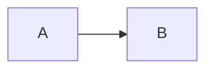

# A### — <Short name>

| | |
|---|---|
| **Date** | YYYY-MM-DD |
| **Design-thinking stage** | Empathize / Define / Ideate / Prototype / Test |
| **Area** | Pipelines / Ontology / AI / App / Monitoring / Scope / Process |
| **Status** | Trying · Kept · Dropped · Parked |
| **Replaces** | A### (or "none") |

## What changed
| Before | Now | Why |
|---|---|---|
| | | |

## The idea in 3 lines
1.
2.
3.

## How we tested it
What we measured, and how.

## Result
Numbers first. Before → after.

## Verdict
Keep / drop / park, and the one-line reason.

## Diagram (if structure changed)

## Persona check
- 🩺 PV SME:
- 💊 Safety Officer:
- 🧐 Evaluator:
