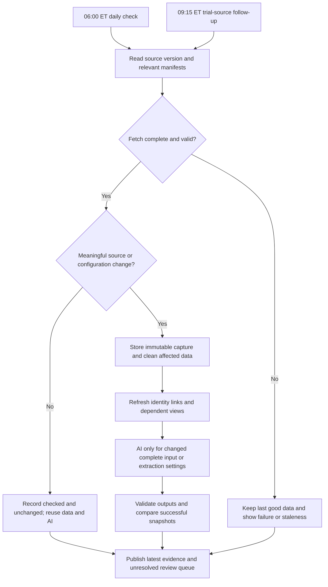

# Every morning: check for changes, then review the latest evidence

_Design-thinking stage: Prototype → Test. Proposed engine behavior; no Foundry schedule or automation was created. Researched October 31, 2026. Existing project files are unchanged._

## What the officer checks every morning

1. New or changed evidence since the previous successful review baseline: label safety text, report counts when a new release arrives, recall evidence and supporting updates.
2. Previously unresolved flags. A quiet source does not close an investigation or erase a saved decision.
3. Source coverage and freshness: what was successfully checked, when the publisher last updated it, and any failed or incomplete refresh.

**Daily review is an operational habit, not a promise that every source publishes daily.** “No change; last source release July 30; checked this morning” is a legitimate result. A successful fetch today does not make old source data current.

## Actual source cadence vs our proposed polling

Exact clock times are reported only when supported. A daily file, HTTP Date header or observed timestamp is not a release-time guarantee. `ET` below means America/New_York, with daylight-saving changes; do not hard-code a UTC offset. The time zone is not inferred for a source timestamp that lacks one.

| Source / surface actually used | Publisher cadence | Publisher time/day | Proposed engine check |
|---|---|---|---|
| FAERS through openFDA event API | Quarterly; FDA says the API may lag by three months or more | Exact quarterly release date/hour not established by the endpoint documentation | Daily 06:00 ET: check public metadata/release availability. Fetch approved drug-query snapshots only when changed or repair needed; current drug-filtered capture needs API-key issue resolved. |
| DailyMed labels | Daily, weekly and monthly update files are provided; each particular label changes only when a new version is published | No exact daily publication hour verified. Do not confuse the RxNorm mapping update inside DailyMed with all label publication. | Daily 06:00 ET: inspect relevant label IDs/history/feed/update files; download newly observed document contents. |
| RxNorm downloadable releases | Full release first Monday of month, Tuesday if Monday is a US federal holiday; weekly updates Wednesday | No exact clock hour verified. Official overview describes holiday handling; check the actual release manifest. | Daily 06:00 ET: check release identity. Remap/revalidate only after actual reference changes. Next listed monthly release is Nov 2, 2026. |
| RxNav API used for pilot mappings | Updated following full monthly RxNorm releases | Do not assume the API contains every weekly file update | Daily 06:00 ET: compare `version.json`; reuse mappings if unchanged. |
| FDA enforcement through openFDA | Weekly | No exact API publication weekday/hour verified from its documentation. Do not assume a report's date is the API refresh time. | Daily 06:00 ET: inspect metadata and fetch the small selected recall snapshot when needed. Reported lifecycle status remains unverified without follow-up. |
| Drugs@FDA downloadable files | Each morning, Monday–Friday | Exact clock hour not published on the checked page | Daily 06:00 ET: inspect source version/hash. If using its openFDA mirror instead, track that mirror's metadata separately rather than claiming identical release timing. |
| NDC Directory | Daily | Exact clock hour not established on the checked page | Daily 06:00 ET: inspect selected products/metadata. Track the actual openFDA mirror update date when using that API. |
| Safety-related Labeling Changes (SrLC) | Regulatory change entries are posted/updated; fixed daily delivery cadence not verified | Exact clock time not established; approval date and database update date are distinct | Daily 06:00 ET: compare relevant product entries and dates/content. |
| ClinicalTrials.gov | Weekday refresh; NLM documentation describes generally by 09:00 ET | Typical completion time, not a guarantee. Check API `dataTimestamp`; record a zone-less returned timestamp verbatim | Morning dashboard can show previous successful capture; perform second check at 09:15 ET and refresh only after the source version changes. |

OnSIDES is an optional published extraction benchmark, not a daily operational feed or independent clinical ground truth. Watch release versions only if it is later used. No licensed terminology dump is included in this dataset.

### Sources checked

- [FDA event API cadence and limitations](https://open.fda.gov/apis/drug/event/).
- [DailyMed periodic releases](https://dailymed.nlm.nih.gov/dailymed/spl-resources-all-drug-labels.cfm).
- [RxNorm release schedule](https://www.nlm.nih.gov/research/umls/rxnorm/overview.html) and [RxNav API update rule](https://lhncbc.nlm.nih.gov/RxNav/APIs/).
- [FDA enforcement API](https://open.fda.gov/apis/drug/enforcement/).
- [Drugs@FDA download schedule](https://www.fda.gov/drugs/drug-approvals-and-databases/drugsfda-data-files) and [NDC Directory](https://www.fda.gov/drugs/drug-approvals-and-databases/national-drug-code-directory).
- [SrLC coverage](https://www.fda.gov/drugs/drug-safety-and-availability/drug-safety-related-labeling-changes-srlc-database-overview-updates-safety-information-fda-approved).
- [ClinicalTrials.gov API](https://clinicaltrials.gov/data-api/api); weekday/09:00 ET schedule also appears in the [NLM modernized-site webinar](https://www.nlm.nih.gov/oet/ed/ct/2024/6-6_ctg-modern_508c.pdf). The direct page is client-rendered in this capture, so do not claim its returned HTML independently confirmed the schedule. Live `version` evidence is saved.

## How the proposed engine runs

**06:00 ET is our selected polling time, not a publisher commitment. 07:00 ET is a target dashboard readiness time, not an achieved service guarantee.** If a source publishes later, its changes appear at the next check. A later same-day check can be added only if needed; do not claim instant detection.

[Editable draw.io source](diagrams/20-daily-check-v1.drawio).

### What actually counts as a change

| Change | Engine response |
|---|---|
| Same source version/content; only retrieval time changed | Record successful check. No new safety flag and no label AI call. |
| Label formatting changed | Retain new provenance; if normalized safety text and actual AI inputs are unchanged, reuse extraction. |
| Safety passage changed | Extract only affected actual inputs; validate quotes/context; flag a reviewed text/concept difference with both versions. |
| Drug mapping/reference changed | Rejoin/recompute affected comparisons even when raw label text is unchanged; rerun AI only if supplied context changed. |
| FAERS release changed | Refresh query-consistent counts; do not sum snapshots or interpret count changes as daily incident cases. |
| Recall record/product/lots changed | Refresh evidence and matching; do not infer hospital stock or current active status from source status alone. |
| A fetch failed or only some pages/queries completed | Do not replace the last complete good data. Show the failure and which source is affected. |
| Prompt/model/parser/schema changed | Version the configuration; do not label model-induced output differences as new source safety events. |

Publish three distinct dates where available: source update/effective date, retrieval/check time and last successful pipeline build. Preserve source dates without inventing a time-of-day. Compare meaningful evidence fingerprints so old triage decisions remain saved but require review when their supporting evidence changes. Without a previous complete capture, establish a baseline rather than calling every row a new event.

## Live observations from this task

See `shared/source-manifest.json` for authoritative requests, timestamps, hashes and errors. Captured examples report FAERS metadata `2026-07-30`, recall data `2026-10-21`, NDC data `2026-10-30`, RxNorm `05-Oct-2026`, and trial API `dataTimestamp=2026-10-30T09:00:04` (no zone in the returned string). These are observations of the captured surfaces, not universal release promises.

Two drug-filtered FAERS requests returned HTTP 403 with `API_KEY_MISSING`. No credential was supplied or requested from another account. A successful unfiltered aggregate is retained for the shared test cases. It is never represented as an oxycodone count. This is a source-access blocker for claiming live drug-specific count refreshes.
